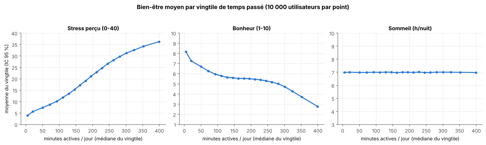
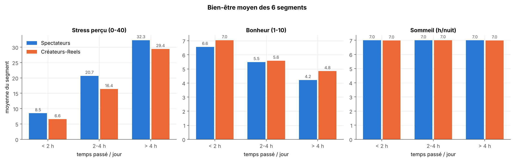
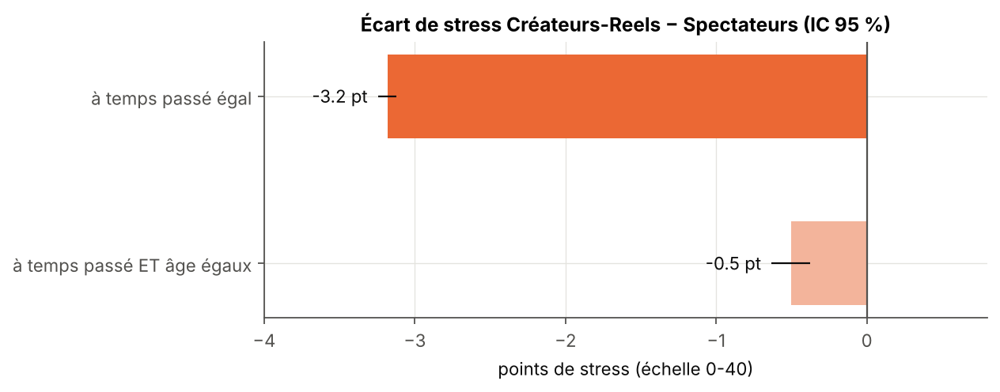
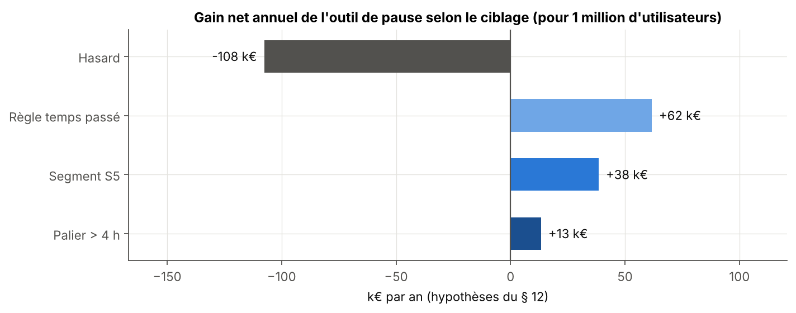

# Instagram : usage et bien-être, une segmentation de 200 000 utilisateurs

**Epitech Paris · MBA · Bootcamp Data · Rush 4** · octobre 2026 · équipe de 5

Étude menée pour la Direction Innovation d'Instagram (cas fictif) : l'usage de la plateforme est-il lié au stress, au sommeil et au bonheur, et quels types d'utilisateurs les équipes produit doivent-elles distinguer ? Nous livrons une segmentation en 6 groupes, ses critères d'évaluation, une simulation économique et un cadre RGPD (UE et Royaume-Uni).


---

## En bref

| | |
|---|---|
| **Question** | Le temps passé sur Instagram est-il lié au bien-être des utilisateurs, et quels groupes distinguer ? |
| **Données** | Panel de 200 000 utilisateurs (réplique synthétique), 58 champs d'activité, de profil et de bien-être. |
| **Résultat** | Le stress suit fortement le temps passé (corrélation de **0,84**) : le temps seul explique **71 %** des écarts de stress. Le bonheur baisse un peu. Le sommeil ne bouge pas. |
| **Livrable** | **6 segments** (3 paliers de temps × 2 styles d'usage), de 7,7 % à 25 % des utilisateurs, assignables avec 3 compteurs d'activité, stables à **99,5 %**. **7 critères sur 8** atteints. |
| **Recommandation** | Agir sur le temps passé, jamais sur la santé : un rappel de pause au-delà de 4 h 36 par jour rapporte **+62 k€ par an pour 1 million d'utilisateurs**, alors qu'un ciblage au hasard en perd 108 k€. |

---

## Résultats clés

**1. Plus de temps, plus de stress.** Le stress monte régulièrement avec le temps passé, le bonheur baisse un peu, le sommeil ne change pas.



**2. Six segments : combien de temps, et comment.** Trois paliers de temps (moins de 2 h, 2 à 4 h, plus de 4 h) croisés avec deux styles : les « Spectateurs » et les « Créateurs-Reels ».



**3. Au-delà du temps, le style dit peu.** À temps égal, les Créateurs-Reels déclarent 3,2 points de stress en moins (sur 40), mais seulement 0,5 point à âge égal : ils sont surtout plus jeunes. Le style sert à concevoir des fonctionnalités, pas à prédire le bien-être.



**4. Un outil de pause n'est rentable que s'il est bien ciblé.** Il faut que 2 personnes ciblées sur 3 soient vraiment à risque.



---

## Protection des données

- Les données sont traitées comme personnelles : **aucun fichier de données n'est publié**, et le notebook n'affiche **aucune ligne individuelle**. Chaque chiffre porte sur au moins 100 personnes.
- Les segments reposent uniquement sur 3 compteurs d'activité. Les données de santé et de bien-être ne servent qu'à les évaluer, de façon agrégée.
- Un segment peut révéler un état de santé sans utiliser de donnée de santé : ce risque est analysé.
- **Mineurs** : protéger, jamais cibler. Le coût d'une protection par défaut est chiffré (environ 120 k€ par an pour 1 million d'utilisateurs).

Analyse complète (finalité, bases légales, mineurs, risque d'inférence santé, sources) : [note RGPD](docs/note_rgpd.md). Ce n'est pas un avis juridique.

---

## Contenu du dépôt

```
notebooks/rush4_segmentation.ipynb   notebook final, exécuté de haut en bas
slides/                              support de la soutenance
figures/                             graphiques produits par le notebook
outputs/                             résultats agrégés : profils des segments, critères, métriques
docs/
  guide_technique.md                 choix des données, détail des résultats, qui a fait quoi
  note_rgpd.md                       note RGPD UE / Royaume-Uni, sourcée
data/                                emplacement des données (non publiées)
requirements.txt
```

## Reproduire les résultats

Les deux extraits de données ont été fournis par Epitech et ne sont pas publiés. Pour relancer, les placer dans `data/` (voir [data/README.md](data/README.md)), puis :

```bash
pip install -r requirements.txt
jupyter notebook notebooks/rush4_segmentation.ipynb
```

Le notebook donne les mêmes résultats à chaque exécution (`SEED = 42`) et vérifie lui-même ses métriques contre `outputs/metrics.json`.

---

## Limites

Des associations, pas des causes. Un panel de volontaires, non représentatif de tous les utilisateurs. Des données synthétiques et des mesures déclaratives. Détail dans le [guide technique](docs/guide_technique.md).

---

## Équipe

| Membre | Rôle |
|---|---|
| Bradley | Exploration, bien-être, variables, critères, segmentation et évaluation |
| Mehdi | Dépôt, choix des extraits de données, affectation d'un nouvel utilisateur, reproductibilité du notebook |
| Marco | Cadrage et critères de réussite, risque d'inférence santé, limites, vérification finale |
| Kiyani | RGPD : finalité, base légale, transparence, mineurs |
| Talel Ouertani | Recommandations produit, simulation économique, slides de soutenance |
